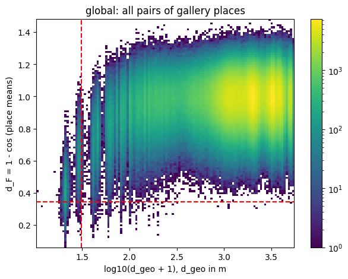

# DenseUAV Baseline on Kaggle — Code Analysis, Reproduction & Improvements

This repository contains the author's official baseline from the [DenseUAV](https://github.com/Dmmm1997/DenseUAV) GitHub repository (commit `b8de187`, Apache-2.0, see [baseline/LICENSE](baseline/LICENSE)) in the `baseline/` folder, made to run on **Kaggle GPUs (T4 x2)**. It adds scripts that reproduce the paper's Tables V–VII and three proposed improvements (CT1–CT3).

Full results with discussion (in Vietnamese): [RESULTS.md](RESULTS.md).

**Round 2 (Oct 2026):** [experiments/](experiments/) holds the Kaggle notebooks (`baseline06*.ipynb`, `denseuav_optim_t4x2.ipynb`, `baselinetest03.ipynb`), the reports [baocao_baseline06.md](experiments/baocao_baseline06.md) / `.tex`, `baocao_gui_thay.tex`, figures and the shape-vector review (`contrib/`). Best result: LPN-B2 + IRP head with D4 TTA + DBA, **87.43 R@1 / 90.22 SDM@1** (1 seed).

---

## Table of Contents

1. [Overview](#overview)
2. [Directory Structure](#directory-structure)
3. [Changes from the Original Code](#changes-from-the-original-code)
4. [Model Architecture](#model-architecture)
5. [Dataset & Data Loading](#dataset--data-loading)
6. [Loss Functions](#loss-functions)
7. [Training Pipeline](#training-pipeline)
8. [Inference & Testing](#inference--testing)
9. [Evaluation Metrics](#evaluation-metrics)
10. [Configuration Reference (`configs.py`)](#configuration-reference-configspy)
11. [Benchmark Results](#benchmark-results)
12. [Improvements (CT1–CT3)](#improvements-ct1ct3)
13. [Dependencies](#dependencies)
14. [Training on Kaggle GPU](#training-on-kaggle-gpu)
15. [Quick Start](#quick-start)

---

## Overview

The baseline implements **cross-view geo-localization** between UAV-view (drone) images and satellite-view images. Given a query drone image, the goal is to retrieve the satellite image of the same place from a gallery, without using GPS.

The system is trained on the **DenseUAV** dataset (2256 training locations; 777 query locations and 3033 gallery locations at test time) and evaluated with standard retrieval metrics (Recall@K, AP) and the spatial metric SDM@K.

**Key design decisions:**

- **Shared backbone**: drone and satellite images pass through the same feature extractor
- **Modular architecture**: backbone and head are chosen independently with `--backbone` / `--head`
- **Multi-loss training**: classification loss + metric-learning (triplet) loss + KL mutual learning
- **One run = one script call**: every experiment is a list of runs in `configs.py`, each run only lists the arguments that differ from the repo's `train_test_local.sh`

---

## Directory Structure

```
.
├── README.md
├── RESULTS.md                  # Full results tables and discussion
├── figures/                    # CT3 error-diagnosis figures
└── baseline/
    ├── train.py                # Main training entry point (original)
    ├── test.py                 # Feature extraction / inference (original)
    ├── evaluate_gpu.py         # Recall@K & AP (original, numpy 2 fix)
    ├── evaluateDistance.py     # SDM@K and MA@K from GPS (original, numpy 2 fix)
    ├── train_test_local.sh     # Original convenience script, Kaggle paths
    ├── requirments.txt         # Original requirements (sic)
    │
    ├── configs.py              # [Kaggle] Train settings of every experiment + paper numbers
    ├── setup_kaggle.py         # [Kaggle] pip install, dataset check, self-test
    ├── train_kaggle.py         # [Kaggle] train → test → evaluate (→ inference time) for one experiment
    ├── evaluate_kaggle.py      # [Kaggle] Collect metrics into a table vs. the paper
    ├── geo_utils.py            # [CT] Sampler, local-consistency loss, integral descriptor, error types
    ├── train_geo.py            # [CT2] train.py with GeoSampler + local-consistency loss
    ├── analyze_ct.py           # [CT1/CT3] Re-ranking and error diagnosis
    │
    ├── models/
    │   ├── taskflow.py         # Top-level Model (backbone + head)
    │   ├── Backbone/
    │   │   └── backbone.py     # ViT-S / DeiT-S / Swinv2-T (timm)
    │   └── Head/
    │       ├── head.py         # Head factory
    │       ├── SingleBranch.py # SingleBranch / SingleBranchSwin
    │       ├── FSRA.py
    │       ├── LPN.py
    │       └── utils.py        # ClassBlock, Pooling
    │
    ├── datasets/
    │   ├── make_dataloader.py      # Dataset factory + augmentation pipeline
    │   ├── Dataloader_University.py# Paired drone/satellite dataset, sampler, collate
    │   ├── queryDataset.py         # Test transforms, RotateAndCrop, RandomErasing
    │   └── autoaugment.py
    │
    ├── losses/
    │   ├── loss.py             # Combines cls + feature + KL losses
    │   ├── TripletLoss.py      # Triplet, HardMining, SameDomain, WeightedSoft
    │   └── FocalLoss.py
    │
    ├── optimizers/
    │   └── make_optimizer.py   # SGD with backbone LR = 0.3 × lr, MultiStepLR
    │
    └── tool/
        ├── utils.py            # Logging, seeds, saving, copying code into checkpoints/
        └── get_inference_time.py   # thop Params/MACs + timing (prints one parseable line)
```

`checkpoints/` (created by training) and `results/` (tables, figures) are git-ignored.

---

## Changes from the Original Code

Only what the experiments use is kept: the backbones and heads below, the losses of Table VII, and the train/test/evaluate scripts. CNN heads, GeM/NetVLAD, other backbones, dataset-preprocessing, visualisation and MA/RDS scripts were removed. Besides that, only compatibility fixes; the training logic is unchanged.

| File | Change | Reason |
| --- | --- | --- |
| `evaluateDistance.py`, `evaluate_gpu.py` | `np.bool8` → `np.bool_`, `np.in1d` → `np.isin` | removed in numpy 2 |
| `models/Head/SingleBranch.py` | `SingleBranchSwin` flattens `(B, H, W, C)` to `(B, N, C)` before pooling | timm 1.x Swin returns NHWC; no-op on 3-D input |
| `tool/get_inference_time.py` | `yaml.safe_load`; prints `Params=… Macs=… InferTime=…s` | PyYAML 6; parseable output |
| `losses/__Init__.py` → `__init__.py`; empty `__init__.py` in `datasets/`, `optimizers/`, `tool/` | | imports on Linux |
| `train_test_local.sh` | `root_dir` = `$DENSEUAV_ROOT` or the Kaggle input path; `num_worker=$(nproc)` | Kaggle |

---

## Model Architecture

### Top-Level: `Model` (`models/taskflow.py`)

```
Model
├── backbone   → make_backbone(opt)   # Shared feature extractor
└── head       → make_head(opt)       # Aggregation + classifier
```

```python
def forward(self, drone_image, satellite_image):
    drone_res     = self.head(self.backbone(drone_image))      # (logits, feature)
    satellite_res = self.head(self.backbone(satellite_image))  # (logits, feature)
    return drone_res, satellite_res
```

Either input can be `None` to run single-view inference. `load_from` loads matching weights from a checkpoint.

### Backbones (`models/Backbone/backbone.py`)

The three backbones of Table V, created with `timm.create_model(..., pretrained=True)`.

| Key | timm model | Output channels | Input |
| --- | --- | --- | --- |
| `ViTS-224` | `vit_small_patch16_224` | 384 | 224 |
| `DeitS-224` | `deit_small_distilled_patch16_224` | 384 | 224 |
| `Swinv2T-256` | `swinv2_tiny_window16_256` | 768 | 256 |

### Heads (`models/Head/`)

#### `SingleBranch` (transformers)

`--head_pool` chooses the descriptor from the token sequence:

| `head_pool` | Descriptor |
| --- | --- |
| `global` | class token — the paper's **Global** head |
| `avg` | mean of patch tokens (default in `train_test_local.sh`) |
| `max` | max over patch tokens |
| `avg+max` | sum of both |

followed by a `ClassBlock` (bottleneck `num_bottleneck=512`, dropout 0.5, classifier over 2256 classes). `SingleBranchSwin` averages Swin tokens (Swin has no class token).

#### `FSRA` and `LPN` — part-based heads

A global branch plus `--block` part branches, each with its own classifier. At test time the part descriptors are stacked into one descriptor. The paper's Table VI uses `block=2`.

---

## Dataset & Data Loading

### Expected Directory Layout

```
DenseUAV/
├── Dense_GPS_ALL.txt           # GPS of every train and test location
├── train/
│   ├── drone/{class_id}/        # drone images
│   └── satellite/{class_id}/    # satellite image
└── test/
    ├── query_drone/{class_id}/
    └── gallery_satellite/{class_id}/
```

On Kaggle this is the dataset `netvoych1k/denseuav`, mounted at `/kaggle/input/datasets/netvoych1k/denseuav/DenseUAV` (found automatically by searching for `Dense_GPS_ALL.txt`). `setup_kaggle.py` checks the class counts: 2256 / 2256 / 777 / 3033.

### `Dataloader_University`

- Returns paired `(satellite, drone)` images with a shared class label
- `Sampler_University` shuffles the classes and repeats each `sample_num` times per epoch (`sample_num=1` here), so the labels in a batch are distinct
- `train_collate_fn` builds the two-view batch

### Augmentation Pipeline (`datasets/make_dataloader.py`)

| Flag | Effect | Setting used |
| --- | --- | --- |
| `rr` | `RotateAndCrop(0.5)` | `uav` |
| `ra` | `RandomAffine(180)` | `satellite` |
| `re` | `RandomErasing(p=erasing_p=0.3)` | `satellite` |
| `cj` | `ColorJitter(0.5, 0.1, 0.1)` | `no` |
| always | Resize to h×w, pad, RandomHorizontalFlip, ImageNet normalization | |

---

## Loss Functions

```
L_total = L_cls(drone) + L_cls(satellite) + L_feature + L_KL
```

| Flag | Options (`"no"` disables the term) |
| --- | --- |
| `cls_loss` | `CELoss`, `FocalLoss` (α=0.25, γ=2) |
| `feature_loss` | `TripletLoss` (margin 0.3), `HardMiningTripletLoss` (margin 0.3), `SameDomainTripletLoss` (margin 0.3), `WeightedSoftTripletLoss` (soft-margin, α=3, **default**), `ContrastiveLoss` |
| `kl_loss` | `KLLoss`: `KLDivLoss(log_softmax(drone logits), softmax(satellite logits))`, batch mean |

For part-based heads every term is averaged over the branches.

---

## Training Pipeline

**Entry point:** `train.py` (called by `train_kaggle.py` with the arguments from `configs.py`)

1. Build the paired dataloader (`batchsize=16`)
2. `make_model(opt)`; `opt.in_planes` is set from the backbone
3. Optimizer: **SGD** (momentum 0.9, Nesterov, weight decay 5e-4), backbone LR = `0.3 × lr`, head LR = `lr`
4. Schedule: `MultiStepLR`, milestones 70 and 110, γ=0.1, **120 epochs**
5. Forward pass under `autocast`; gradient scaling only with `--autocast` (not used here)
6. Checkpoint saved at epoch 119 (`net_119.pth`); the code and `opts.yaml` are copied into `checkpoints/{name}/`
7. Seed fixed to 666

On a Kaggle T4 one 120-epoch run takes about **1 h 50 min**. Training is limited by JPEG decoding on the 4 vCPUs, so runs go one after another on GPU 0.

---

## Inference & Testing

**Entry point:** `test.py`, run inside `checkpoints/{name}/` (which holds the copied code and `opts.yaml`).

1. Loads `net_119.pth` and the training options (input size etc.) from `opts.yaml`
2. Mode 1: drone query → satellite gallery (used for all results)
3. Features of the image and its horizontal flip are summed, then L2-normalized
4. Writes `pytorch_result_1.mat` (query/gallery features and labels)

`tool/get_inference_time.py` reports Params / MACs (thop) and the time of 2000 batch-1 forward passes; on a T4 the absolute time differs from the paper, so compare it across rows.

---

## Evaluation Metrics

### `evaluate_gpu.py` → `results.txt`

| Metric | Description |
| --- | --- |
| **Recall@1/5/10** | % of queries with a correct gallery image in the top K |
| **Recall@top1** | % with a correct image in the top 1% of the gallery |
| **AP** | mean Average Precision |

### `evaluateDistance.py` → `SDM@K(1,100).json`, `MA@K(1,100)`

**SDM@K** (Spatial Distance Metric) rewards retrieving places that are close to the truth, not only the exact place:

```
SDM@K = Σ_{i=1..K} w_i · exp(−5000 · d_i) / Σ w_i,   w_i = (K − i + 1) / K
```

where `d_i` is the Euclidean distance in degrees (lon, lat) between the query and the i-th result. **MA@K** is the fraction of queries whose top-1 result is within K metres.

`evaluate_kaggle.py` reads both files (and `infer.txt`) and builds the table next to the paper's numbers.

---

## Configuration Reference (`configs.py`)

`BASE` mirrors `train_test_local.sh`:

| Parameter | Value | Description |
| --- | --- | --- |
| `backbone` | `ViTS-224` | Backbone key |
| `head` / `head_pool` | `SingleBranch` / `avg` | Head and token pooling |
| `block` | `1` | Parts for FSRA / LPN |
| `num_bottleneck` | `512` | Descriptor dimension |
| `h` / `w` | `224` / `224` | Input size |
| `batchsize` | `16` | |
| `lr` | `0.01` | Head LR (backbone 0.3×) |
| `sample_num` | `1` | Repeats per class per epoch |
| `cls_loss` | `CELoss` | |
| `feature_loss` | `WeightedSoftTripletLoss` | |
| `kl_loss` | `KLLoss` | |
| `rr` / `ra` / `re` / `cj` | `uav` / `satellite` / `satellite` / `no` | Augmentations |
| `load_from` | `no` | |
| `gpu_ids` / `num_worker` | `0` / all CPUs | |

Experiments (each run overrides only a few keys):

| Experiment | Runs | Paper table |
| --- | --- | --- |
| `heads_repo` | `Global`, `FSRA_B2`, `LPN_B2` — repo losses, lr 0.01, `head_pool=global` | VI |
| `heads_paper` | `paper_Global` (lr 0.003), `paper_FSRA_B2`, `paper_LPN_B2` — CE + HardMiningTriplet, no KL | VI |
| `backbones` | `DeiT-S`, `Swinv2-T` (`SingleBranchSwin`, 256 px) | V |
| `losses` | `loss_ce`, `loss_focal`, `loss_ce_triplet`, `loss_ce_hardtriplet`, `loss_ce_samedomain`, `loss_ce_softtriplet`, `loss_ce_softtriplet_kl` | VII |
| `ct` | `global` (baseline), `geo_lc` (CT2, `train_geo.py`) | — |

---

## Benchmark Results

DenseUAV test set, drone → satellite, one run per row on a Kaggle T4. Run-to-run noise is about ±1 R@1. Full tables: [RESULTS.md](RESULTS.md).

### Heads (Table VI)

| Head | Setup | Params | R@1 | R@5 | AP | SDM@1 | paper R@1 |
| --- | --- | --- | --- | --- | --- | --- | --- |
| Global | repo | 22.93M | 81.85 | 94.17 | 70.60 | 84.96 | 80.18 |
| FSRA B=2 | repo | 25.64M | 84.43 | 95.54 | 74.45 | 87.20 | 82.58 |
| LPN B=2 | repo | 25.64M | **86.06** | **96.35** | **75.90** | **88.74** | 83.05 |
| Global | paper | 22.93M | 79.45 | 93.52 | 69.10 | 83.92 | 80.18 |
| FSRA B=2 | paper | 25.64M | 84.51 | 95.67 | 73.32 | 87.69 | 82.58 |
| LPN B=2 | paper | 25.64M | 84.34 | 95.80 | 73.77 | 87.48 | 83.05 |

### Backbones (Table V)

| Backbone | Params | MACs | R@1 | R@5 | SDM@1 | paper R@1 |
| --- | --- | --- | --- | --- | --- | --- |
| DeiT-S | 22.93M | 8.53G | 76.71 | 90.78 | 80.22 | 71.77 |
| Swinv2-T | 22.65M | 8.89G | 80.52 | 93.65 | 83.79 | 77.99 |
| ViT-S | 22.93M | 8.48G | **81.85** | **94.17** | **84.96** | 80.18 |

### Losses (Table VII)

| Loss | R@1 | SDM@1 | paper R@1 | paper SDM@1 |
| --- | --- | --- | --- | --- |
| CE | 75.25 | 78.88 | 76.28 | 81.23 |
| Focal | 74.13 | 78.25 | 73.19 | 79.14 |
| CE + Triplet | 72.50 | 76.19 | 79.19 | 83.63 |
| CE + HardMining Triplet | 79.54 | 82.70 | 80.18 | 84.39 |
| CE + SameDomain Triplet | 81.42 | 84.34 | 81.17 | 85.09 |
| CE + SoftWeighted Triplet | **83.01** | **86.10** | 81.17 | 85.22 |
| CE + SoftWeighted Triplet + KL | 82.58 | 85.46 | 83.01 | 86.50 |

6 of 7 rows are within 1.5 R@1 of the paper; CE + Triplet is 6.7 points below (not re-run yet).

---

## Improvements (CT1–CT3)

All on ViT-S + Global head, repo losses.

- **CT2 — local spatial consistency** (`train_geo.py`, `geo_utils.GeoSampler`, `geo_utils.local_consistency_loss`): every class is followed in the batch by up to 3 unused neighbours within 30 m, and an ordinal loss requires the hardest neighbour (≤ 30 m) to be closer in feature space than the closest place > 60 m away. Everything else is `train.py`.
- **CT1 — integral geometric-semantic descriptor** (`geo_utils.integral_descriptor`, `geo_utils.rerank`): k-means (8 clusters) of ViT patch tokens as soft semantic masks, integrated over 4 rings × 8 sectors with a decaying weight; |rFFT| over sectors removes the heading. Used to re-rank the top 50 by z(d_F) + λ·z(d_W), λ = 1 fixed in advance.
- **CT3 — error diagnosis** (`analyze_ct.py`): top-1 errors split into C1 (≤ 30 m), C2 (same campus), C3 (other test campus), C4 (training place), and far errors into "ambiguous pair" vs. "domain gap".

| Variant | R@1 | R@5 | R@10 | SDM@1 | SDM@5 |
| --- | --- | --- | --- | --- | --- |
| global (baseline) | 81.64 | 93.65 | 96.61 | 84.73 | 78.00 |
| global + CT1 | 81.21 | 94.51 | 97.25 | 84.09 | 75.70 |
| **geo_lc (CT2)** | **82.75** | 94.42 | 97.08 | **85.57** | **79.21** |
| geo_lc + CT1 | 81.72 | **94.59** | **97.51** | 84.76 | 76.06 |

CT2 gives +1.1 R@1 / +0.8 SDM@1 (single run). CT1 with λ = 1 lowers top-1; λ = 0.25–0.5 helps on the test set but has to be chosen on a separate validation split. CT3 shows that about 3/4 of far errors are domain gap, not truly similar places.



---

## Dependencies

From `baseline/requirments.txt` (plus PyTorch/torchvision, preinstalled on Kaggle):

```
scipy
tqdm
pyyaml
matplotlib
opencv-python
timm
pillow
einops
thop
pytorch_metric_learning
```

`evaluate_kaggle.py` and `analyze_ct.py` also use `pandas` and `scikit-learn` (preinstalled on Kaggle).

---

## Training on Kaggle GPU

**1. Notebook settings:** Accelerator `GPU T4 x2`, Internet `On`, add the input dataset `netvoych1k/denseuav`. Outside Kaggle, set `DENSEUAV_ROOT` to the folder that contains `Dense_GPS_ALL.txt`.

**2. Get the code and install (first cell):**

```bash
cd /kaggle/working
git clone https://github.com/DS-PNQ/DENSEUAV-project.git
cd DENSEUAV-project/baseline
python setup_kaggle.py
```

**3. Train + test one experiment** (use *Save & Run All* so the session keeps running):

```bash
python train_kaggle.py heads_repo            # all runs of the experiment
python train_kaggle.py heads_repo LPN_B2     # or only some runs
```

Each run is about 1 h 50 min and a Kaggle session is limited to 12 h, so `losses` (7 runs) has to be split over two sessions. Runs that already have `results.txt` are skipped.

**4. Collect the results:**

```bash
python evaluate_kaggle.py heads_repo         # prints the table, writes results/heads_repo.csv
```

**5. Improvements:**

```bash
python train_kaggle.py ct && python evaluate_kaggle.py ct && python analyze_ct.py
```

Checkpoints are in `baseline/checkpoints/<run>/` (`net_119.pth`, `opts.yaml`, `results.txt`, `SDM@K(1,100).json`, `pytorch_result_1.mat`); tables and figures in `baseline/results/`. Everything under `/kaggle/working` is saved as notebook output.

---

## Quick Start

```bash
cd baseline
python setup_kaggle.py

# 1. Train + extract features + evaluate, for one run
python train_kaggle.py heads_repo Global

# 2. Results table vs. the paper
python evaluate_kaggle.py heads_repo
```

Or the original convenience script (uses `root_dir` / `name` set at its top):

```bash
cd baseline
bash train_test_local.sh
```
