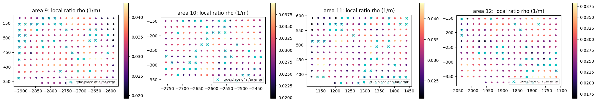
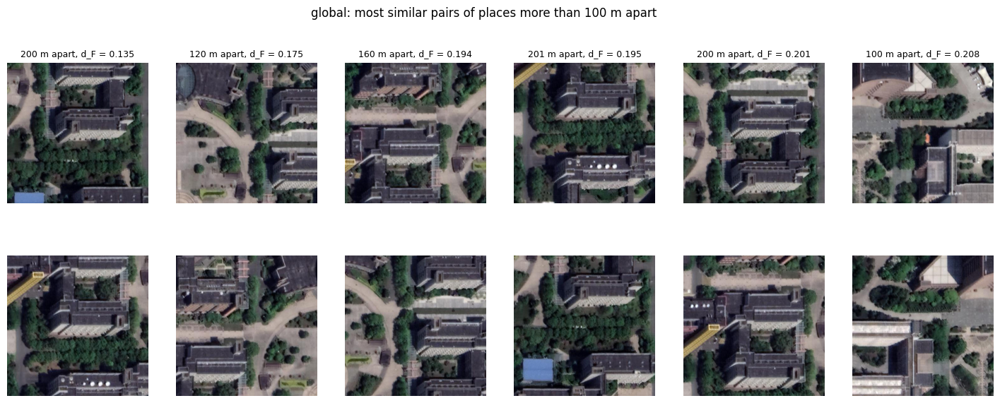

# Báo cáo kết quả

Tất cả chạy trên Kaggle (Tesla T4, 4 vCPU), ViT-S/224 trừ khi ghi khác, SGD, batch 16, 120 epoch, LR x0.1 ở epoch 70/110, augment `rr=uav`, `ra/re=satellite`. Đánh giá bằng `evaluate_gpu.py` (Recall@K, AP) và `evaluateDistance.py` (SDM@K) của repo gốc trên 2331 ảnh drone query / 18198 ảnh vệ tinh gallery. Mỗi cấu hình chạy một lần, nên chênh lệch khoảng ±1 R@1 là nhiễu giữa các lần chạy.

## 1. Head (Table VI)

### 1a. Cấu hình mặc định của repo (CE + WeightedSoftTriplet + KL, lr 0.01) — `python train_kaggle.py heads_repo`

| Head | Params | MACs | InferTime (T4) | R@1 | R@5 | R@10 | AP | SDM@1 | paper R@1 | paper R@5 |
|---|---|---|---|---|---|---|---|---|---|---|
| Global | 22.926M | 8.484G | 33.8s | 81.85 | 94.17 | 97.08 | 70.60 | 84.96 | 80.18 | 93.99 |
| FSRA (B=2) | 25.637M | 8.490G | 36.2s | 84.43 | 95.54 | 98.24 | 74.45 | 87.20 | 82.58 | 94.94 |
| LPN (B=2) | 25.637M | 8.490G | 35.6s | **86.06** | **96.35** | **98.50** | **75.90** | **88.74** | 83.05 | 94.89 |

### 1b. Cấu hình theo bài báo (CE + HardMiningTriplet, không KL; lr 0.003 Global / 0.01 FSRA, LPN) — `python train_kaggle.py heads_paper`

| Head | Params | MACs | InferTime (T4) | R@1 | R@5 | R@10 | AP | SDM@1 | paper R@1 | paper R@5 |
|---|---|---|---|---|---|---|---|---|---|---|
| Global | 22.926M | 8.484G | 26.9s | 79.45 | 93.52 | 97.00 | 69.10 | 83.92 | 80.18 | 93.99 |
| FSRA (B=2) | 25.637M | 8.490G | 29.6s | 84.51 | 95.67 | 98.16 | 73.32 | 87.69 | 82.58 | 94.94 |
| LPN (B=2) | 25.637M | 8.490G | 30.1s | 84.34 | 95.80 | 98.20 | 73.77 | 87.48 | 83.05 | 94.89 |

**Nhận xét**
- Với cấu hình bài báo, Global đạt 79.45 R@1, cách bài báo 0.7 điểm, tức là tái hiện được.
- Head chia khối (FSRA, LPN) hơn Global khoảng 3–5 R@1 ở cả hai cấu hình, cao hơn bài báo khoảng 1.5–3 điểm.
- Params thấp hơn bài báo khoảng 0.37M, có thể do thop bản mới bỏ qua head 1000 lớp không dùng của ViT trong timm. InferTime đo trên T4 nên chỉ so được giữa các hàng.

## 2. Backbone (Table V) — `python train_kaggle.py backbones`

Cấu hình repo (CE + WeightedSoftTriplet + KL, lr 0.01), head `SingleBranch` (DeiT-S, cls token) và `SingleBranchSwin` (Swinv2-T, trung bình token, ảnh 256 px).

| Backbone | Params | MACs | InferTime (T4) | R@1 | R@5 | R@10 | AP | SDM@1 | paper R@1 | paper R@5 |
|---|---|---|---|---|---|---|---|---|---|---|
| DeiT-S | 22.926M | 8.527G | 26.6s | 76.71 | 90.78 | 94.59 | 64.54 | 80.22 | 71.77 | 89.70 |
| Swinv2-T | 22.652M | 8.890G | 71.7s | 80.52 | 93.65 | 96.78 | 71.54 | 83.79 | 77.99 | 92.49 |
| ViT-S (Global, mục 1a) | 22.926M | 8.484G | 33.8s | 81.85 | 94.17 | 97.08 | 70.60 | 84.96 | 80.18 | 93.99 |

**Nhận xét:** cả hai backbone đều cao hơn bài báo (DeiT-S +4.9, Swinv2-T +2.5 R@1), nhưng thứ tự ViT-S > Swinv2-T > DeiT-S vẫn giống bài báo. Swinv2-T chậm hơn khoảng 2.7 lần khi suy luận.

## 3. Loss (Table VII) — `python train_kaggle.py losses`

Cấu hình repo, head Global, chỉ thay đổi loss.

| Loss | R@1 | SDM@1 | SDM@3 | SDM@5 | SDM@10 | paper R@1 | paper SDM@1 |
|---|---|---|---|---|---|---|---|
| CE | 75.25 | 78.88 | 76.81 | 72.25 | 59.82 | 76.28 | 81.23 |
| Focal | 74.13 | 78.25 | 76.89 | 72.76 | 61.41 | 73.19 | 79.14 |
| CE + Triplet | 72.50 | 76.19 | 74.18 | 69.77 | 58.21 | 79.19 | 83.63 |
| CE + HardMining Triplet | 79.54 | 82.70 | 81.21 | 77.30 | 65.54 | 80.18 | 84.39 |
| CE + SameDomain Triplet | 81.42 | 84.34 | 82.32 | 78.05 | 65.50 | 81.17 | 85.09 |
| CE + SoftWeighted Triplet | **83.01** | **86.10** | **84.01** | **79.42** | **66.80** | 81.17 | 85.22 |
| CE + SoftWeighted Triplet + KL | 82.58 | 85.46 | 83.79 | 79.11 | 65.96 | 83.01 | 86.50 |

**Nhận xét**
- 6/7 hàng nằm trong khoảng ±1.5 R@1 so với bài báo.
- **CE + Triplet** thấp hơn bài báo 6.7 điểm, và thấp hơn cả CE thuần. Triplet thường (margin cứng, không mining) có vẻ không ổn định với lr 0.01; chưa chạy lại để kiểm tra.
- KL không giúp thêm trong lần chạy này (82.58 so với 83.01 khi không có KL); mức chênh này nằm trong nhiễu.
- Các loss triplet có mining/trọng số mềm hơn rõ rệt so với CE thuần (+4 đến +8 R@1).

## 4. Cải tiến CT1–CT3 — `python train_kaggle.py ct` + `python analyze_ct.py`

Baseline: ViT-S, head Global (cls token), cấu hình repo.

- **CT2** (`geo_lc`): `GeoSampler` gom mỗi lớp với tối đa 3 láng giềng trong 30 m vào cùng batch, cộng thêm loss nhất quán cục bộ có thứ tự (láng giềng ≤ 30 m phải gần hơn trong không gian đặc trưng so với nơi > 60 m), trọng số 1.
- **CT1** (`+CT1`): descriptor tích phân hình học–ngữ nghĩa (k-means 8 cụm trên patch token ViT, 4 vòng × 8 cung, |rFFT| theo cung để bất biến xoay) dùng để re-rank top 50 theo z(d_F) + λ·z(d_W), λ = 1 cố định trước.
- **CT3**: phân loại lỗi top-1 (C0 đúng, C1 sai ≤ 30 m, C2 cùng khu > 30 m, C3 khu test khác, C4 địa điểm train) và nguyên nhân (cặp mơ hồ / lệch miền).

### 4a. Độ chính xác

| Biến thể | R@1 | R@5 | R@10 | AP | SDM@1 | SDM@3 | SDM@5 | SDM@10 |
|---|---|---|---|---|---|---|---|---|
| global (baseline) | 81.64 | 93.65 | 96.61 | 69.33 | 84.73 | 82.67 | 78.00 | 65.13 |
| global + CT1 | 81.21 | 94.51 | 97.25 | — | 84.09 | 80.88 | 75.70 | 62.43 |
| **geo_lc (CT2)** | **82.75** | 94.42 | 97.08 | **70.28** | **85.57** | **83.84** | **79.21** | **66.25** |
| geo_lc + CT1 | 81.72 | **94.59** | **97.51** | — | 84.76 | 81.30 | 76.06 | 62.88 |
| paper Table VI Global | 80.18 | 93.99 | — | — | 84.39 | 82.51 | 78.02 | 66.46 |

Trần của CT1 (ảnh đúng nằm trong top 50): 99.61% (global), 99.31% (geo_lc).

Độ nhạy theo λ (global, đo trên tập test nên chỉ để tham khảo, không dùng để chọn λ):

| λ | 0 | 0.25 | 0.5 | 1 | 2 | 4 |
|---|---|---|---|---|---|---|
| R@1 | 81.64 | 82.07 | **82.63** | 81.21 | 76.62 | 67.65 |
| SDM@1 | 84.73 | 85.07 | **85.46** | 84.09 | 80.02 | 71.52 |

### 4b. Chẩn đoán lỗi (CT3), % số query

| Biến thể | C0 | C1 | C2 | C3 | C4 | lỗi xa do cặp mơ hồ (%) | sai số trung vị khi sai (m) |
|---|---|---|---|---|---|---|---|
| global | 81.64 | 7.55 | 5.79 | 1.29 | 3.73 | 26.19 | 45.15 |
| global + CT1 | 81.21 | 7.04 | 5.71 | 1.20 | 4.85 | 24.82 | 60.40 |
| geo_lc | 82.75 | 6.82 | 5.88 | 0.99 | 3.56 | 30.45 | 50.80 |
| geo_lc + CT1 | 81.72 | 7.55 | 5.45 | 1.03 | 4.25 | 28.80 | 45.75 |

- Trong các lỗi xa của baseline, d_W ưu tiên đúng địa điểm thật ở 81.3% trường hợp (252 lỗi); với geo_lc là 78.6% (243 lỗi).
- Tỉ số Lipschitz cục bộ ρ tại địa điểm thật gần như như nhau giữa query đúng (3.00e-2 /m) và lỗi xa (2.87e-2 /m), nên lỗi xa không tập trung ở chỗ đặc trưng thay đổi đột ngột.
- Baseline: τ = 0.343; 83 cặp địa điểm cách > 100 m nhưng có d_F < τ; chỉ 29/10440 cặp láng giềng ≤ 30 m bị gián đoạn.

### 4c. Kết luận

- **CT2 có ích:** +1.11 R@1, +0.95 AP, +0.84 SDM@1 so với baseline, chủ yếu nhờ giảm lỗi C1 (láng giềng gần) và C3. Đây là một lần chạy, mức tăng gần với nhiễu ±1, nên cần chạy thêm seed để khẳng định.
- **CT1 với λ = 1 không có ích ở top-1:** R@1 và SDM@K giảm, chỉ R@5/R@10 tăng nhẹ, và lỗi C4 (nhầm sang địa điểm train) tăng. λ nhỏ hơn (0.25–0.5) cho kết quả tốt hơn baseline, nhưng phải chọn λ trên tập validation riêng thì mới công bằng.
- **CT3** cho thấy khoảng 3/4 lỗi xa là do lệch miền drone–vệ tinh chứ không phải do hai địa điểm thật sự giống nhau, nên hướng cải tiến tiếp theo nên nhắm vào căn chỉnh miền hơn là vào descriptor hình học.

## 5. Tổng hợp

| Thí nghiệm | Tốt nhất | R@1 | SDM@1 |
|---|---|---|---|
| Head (cấu hình repo) | LPN B=2 | 86.06 | 88.74 |
| Head (cấu hình bài báo) | FSRA B=2 | 84.51 | 87.69 |
| Backbone (head Global) | ViT-S | 81.85 | 84.96 |
| Loss (head Global) | CE + SoftWeighted Triplet | 83.01 | 86.10 |
| Cải tiến (head Global) | CT2 `geo_lc` | 82.75 | 85.57 |
